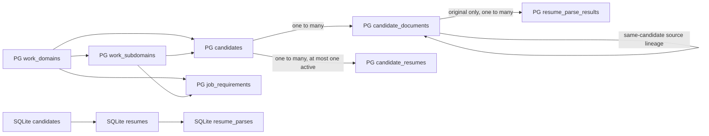

# Jobmitra ATS database audit and proposed design

**Status: analysis and planning only — 5 November 2026.** No database, model, migration, prompt, resume, parsed result or application source was changed for this audit. PostgreSQL was not connected to. SQLite was opened explicitly with `mode=ro`, `PRAGMA query_only=ON` and a read transaction; the processor's write-capable `open_database()` was not called. No migrations, imports, model execution or LLM requests were run.

**Recommendation:** retain PostgreSQL candidates as the business master, retain the existing document/parse histories, and add only an explicit external-candidate crosswalk and a rebuildable ATS search projection. Link the two existing PostgreSQL resume-storage paths instead of treating them as interchangeable. Do not copy every ResumeProfile field into candidate columns or replace manual facts with LLM output.

## Evidence and confidence

| Evidence | What it establishes | Limit |
| --- | --- | --- |
| [Candidate models](../src/jobmitra/modules/candidates/models.py), [JD models](../src/jobmitra/modules/jobs/models.py) | Current intended PostgreSQL column types, nullability, defaults, keys and indexes | Model metadata is not proof of the schema deployed on Windows |
| [Alembic revisions](../migrations/versions/), revisions `0001_company_management` through `0007_candidate_resumes` | Intended upgrade chain; syntax inspection found all seven target tables' column sets agree with current models | No `upgrade()`/`downgrade()` was invoked; no live `alembic_version` was queried |
| [Stage 2 SQL](../outputs/stage-2/0002_jd_tracking.sql), [Stage 3 SQL](../outputs/stage-3/0004_candidate_desk.sql), [0007 reviewed SQL](../outputs/optional-resumes/0006-to-0007-reviewed.sql) | Offline DDL for specific revisions | These are partial migration exports, not a current full catalog export |
| Local `backups/20261019T090641630542Z/*restore-schema.sql` | Historical PostgreSQL schema-only dump, header reports PostgreSQL 18.6; includes `companies`, `company_contacts`, `alembic_version` | Predates the seven audited ATS-related tables; cannot establish their deployed state. Files are private/ignored, not portable report dependencies |
| `../jobmitra-resume-processing/private/jobmitra_candidates.sqlite3` | Actual local SQLite v3 catalog, indexes and FK declarations, read-only snapshot | Does not establish Windows SQLite contents or PostgreSQL deployment state |
| `../jobmitra-resume-processing/app/core/database.py`, `document_store.py`, `eligibility.py`; `run_documents.py`, `run_llm.py` | SQLite bootstrap, identity linking, extraction/masking artifacts and parse-version semantics | Bootstrap behavior can differ from an older upgraded database's physical defaults |
| `../jobmitra-resume-processing/app/schemas/resume.py`, `app/services/llm_parser.py`, `app/services/alter_resume.py` | Actual ResumeProfile structure, validation, output privacy checks and export mapping | Structural validity is not factual verification |
| [SOP bridge](../src/jobmitra/modules/resume_processing/bridge.py), [SQLite adapter](../src/jobmitra/modules/resume_processing/store.py), [service](../src/jobmitra/modules/resume_processing/service.py) | Current control records, warnings, selected parse/review/export linkage and local demo attribution | These changes are currently uncommitted; code inspection does not imply GitHub/Windows deployment |

Paths beginning `../jobmitra-resume-processing` in prose are relative to the **SOP repository root**; that sibling is a separate repository. Report links beginning `../src`, `../migrations`, etc. are relative to this Markdown file. No source credentials or candidate text are reproduced.

**Established:** current source-defined PostgreSQL schema, actual local SQLite schema, storage contracts and structural conflicts. **Unverified:** current live PostgreSQL catalog, which revisions are applied on Windows, record-by-record identity correspondence and factual quality of existing professional profiles. Do not infer current deployment from old review documents or table names.

## 1. Existing PostgreSQL schema

The following is the current SQLAlchemy/migration-defined schema, **not a live catalog assertion**. All listed PostgreSQL PKs are UUIDs generated by Python `uuid4`; the DDL does not define a server-side UUID default. Timestamp columns are `TIMESTAMP WITH TIME ZONE`. `updated_at` uses a server insert default plus an ORM `onupdate`; that is not a database trigger covering arbitrary SQL updates. Nullable `CHECK` operands can remain unknown; a range check does not make an optional column required.

`Identity` supplies `id` and `created_at`; `Updated` supplies `updated_at` where inherited. These inherited fields are included below. Relationships are declared as foreign keys; these models do not define SQLAlchemy `relationship()` collections.

### 1.1 `candidates`

**Grain:** one SOP business candidate. Manual/employee-confirmed and clipboard-derived business fields live here; the table has no per-field verified flag or extraction provenance. Names, mobiles and emails are not globally unique. `version` supports optimistic update checks. Array defaults mean an empty list, not evidence that no skills or preferences exist.

| Column | PostgreSQL type | Nullable | Server default | Python/ORM behavior |
| --- | --- | --- | --- | --- |
| `full_name` | `TEXT` | No | — | — |
| `mobile` | `TEXT` | No | — | — |
| `mobile_normalized` | `TEXT` | No | — | — |
| `email` | `TEXT` | Yes | — | — |
| `source` | `TEXT` | No | — | — |
| `role_title` | `TEXT` | Yes | — | — |
| `domain_id` | `UUID` | Yes | — | — |
| `subdomain_id` | `UUID` | Yes | — | — |
| `qualification` | `TEXT` | Yes | — | — |
| `experience_months` | `INTEGER` | Yes | — | — |
| `skills` | `TEXT[]` | No | `'{}'::text[]` | insert default: list |
| `current_location` | `TEXT` | Yes | — | — |
| `preferred_locations` | `TEXT[]` | No | `'{}'::text[]` | insert default: list |
| `hometown` | `TEXT` | Yes | — | — |
| `home_state` | `TEXT` | Yes | — | — |
| `ready_to_relocate` | `BOOLEAN` | Yes | — | — |
| `current_salary_amount` | `NUMERIC(14, 2)` | Yes | — | — |
| `current_salary_period` | `TEXT` | No | `Unknown` | insert default: Unknown |
| `current_salary_basis` | `TEXT` | No | `Unknown` | insert default: Unknown |
| `expected_salary_amount` | `NUMERIC(14, 2)` | Yes | — | — |
| `expected_salary_period` | `TEXT` | No | `Unknown` | insert default: Unknown |
| `expected_salary_basis` | `TEXT` | No | `Unknown` | insert default: Unknown |
| `last_salary_raw` | `TEXT` | Yes | — | — |
| `notice_period_text` | `TEXT` | Yes | — | — |
| `version` | `INTEGER` | No | `1` | insert default: 1 |
| `id` | `UUID` | No | — | PK; insert default: uuid4 |
| `created_at` | `TIMESTAMP WITH TIME ZONE` | No | `now()` | — |
| `updated_at` | `TIMESTAMP WITH TIME ZONE` | No | `now()` | onupdate: now() |

**Keys, constraints and indexes:**

- Primary key: `id`.
- `unnamed FK`: `(domain_id)` → `(work_domains.id)`; `ON DELETE RESTRICT`.
- `fk_candidate_subdomain_parent`: `(subdomain_id, domain_id)` → `(work_subdomains.id, work_subdomains.domain_id)`; `ON DELETE RESTRICT`.
- `ck_candidate_arrays`: CHECK `array_position(skills,NULL) IS NULL AND array_position(preferred_locations,NULL) IS NULL`.
- `ck_candidate_experience`: CHECK `experience_months >= 0`.
- `ck_candidate_mobile`: CHECK `mobile_normalized ~ '^[0-9]{8,15}$'`.
- `ck_candidate_name`: CHECK `length(btrim(full_name))>0`.
- `ck_candidate_salary`: CHECK `current_salary_amount >= 0 AND current_salary_amount <> 'NaN'::numeric AND expected_salary_amount >= 0 AND expected_salary_amount <> 'NaN'::numeric`.
- `ck_candidate_salary_basis`: CHECK `current_salary_basis IN ('CTC','Gross','Take-home','Unknown') AND expected_salary_basis IN ('CTC','Gross','Take-home','Unknown')`.
- `ck_candidate_salary_period`: CHECK `current_salary_period IN ('Monthly','Annual','Unknown') AND expected_salary_period IN ('Monthly','Annual','Unknown')`.
- `ck_candidate_source`: CHECK `source IN ('Walk-in','Foundit','WhatsApp','Referral','Existing database','Other')`.
- `ck_candidate_subdomain_domain`: CHECK `subdomain_id IS NULL OR domain_id IS NOT NULL`.
- `ck_candidate_version`: CHECK `version > 0`.
- `ix_candidate_domain`: BTREE `(domain_id, subdomain_id)`.
- `ix_candidate_email`: BTREE `(email)`.
- `ix_candidate_mobile`: BTREE `(mobile_normalized)`.
- `ix_candidate_name`: BTREE `(full_name)`.

### 1.2 `candidate_documents`

**Grain:** one candidate-owned, kind-specific document version: original resume, modified resume or authority PDF/DOCX. `version` is scoped to `(candidate_id, kind)`. Modified documents require a same-candidate source and the literal approval label `Reviewed`; the database does not tie that label to a particular parsed JSON hash. The source FK by itself does not constrain the parent's kind to original. The current [DocumentService](../src/jobmitra/modules/candidates/documents.py) additionally requires an `ORIGINAL_RESUME` parent and review confirmation; preserve that stronger service rule.

| Column | PostgreSQL type | Nullable | Server default | Python/ORM behavior |
| --- | --- | --- | --- | --- |
| `candidate_id` | `UUID` | No | — | — |
| `kind` | `TEXT` | No | — | — |
| `original_filename` | `TEXT` | No | — | — |
| `storage_key` | `TEXT` | No | — | — |
| `content_type` | `TEXT` | No | — | — |
| `size_bytes` | `INTEGER` | No | — | — |
| `sha256` | `TEXT` | No | — | — |
| `uploaded_by_staff_id` | `UUID` | Yes | — | — |
| `version` | `INTEGER` | No | — | — |
| `source_document_id` | `UUID` | Yes | — | — |
| `approval_status` | `TEXT` | Yes | — | — |
| `id` | `UUID` | No | — | PK; insert default: uuid4 |
| `created_at` | `TIMESTAMP WITH TIME ZONE` | No | `now()` | — |

**Keys, constraints and indexes:**

- Primary key: `id`.
- `unnamed FK`: `(candidate_id)` → `(candidates.id)`; `ON DELETE RESTRICT`.
- `fk_document_source_candidate`: `(source_document_id, candidate_id)` → `(candidate_documents.id, candidate_documents.candidate_id)`; `ON DELETE RESTRICT`.
- `unnamed FK`: `(uploaded_by_staff_id)` → `(staff_members.id)`; `ON DELETE RESTRICT`.
- `uq_document_candidate`: UNIQUE `(id, candidate_id)`.
- `uq_document_kind`: UNIQUE `(id, kind)`.
- `uq_document_storage`: UNIQUE `(storage_key)`.
- `uq_document_version`: UNIQUE `(candidate_id, kind, version)`.
- `ck_document_content_type`: CHECK `content_type IN ('application/pdf','application/vnd.openxmlformats-officedocument.wordprocessingml.document')`.
- `ck_document_integrity`: CHECK `size_bytes>0 AND version>0 AND sha256 ~ '^[0-9a-f]{64}$'`.
- `ck_document_kind`: CHECK `kind IN ('ORIGINAL_RESUME','MODIFIED_RESUME','AUTHORITY')`.
- `ck_document_lineage`: CHECK `(kind='MODIFIED_RESUME' AND source_document_id IS NOT NULL AND approval_status='Reviewed') OR (kind<>'MODIFIED_RESUME' AND source_document_id IS NULL)`.
- `ck_document_not_self`: CHECK `source_document_id IS NULL OR source_document_id<>id`.
- No additional explicit secondary indexes; primary/unique constraints provide their own indexes.

### 1.3 `candidate_resumes`

**Grain:** one independently uploaded original resume. This is a separate path introduced by revision 0007, not an alias or child of `candidate_documents`. It has no numeric `version` and no `document_id` FK today. Uploading creates a new UUID/storage key, deactivates prior rows for that candidate and preserves old bytes. The partial unique index means **at most** one active row, not that every candidate must have one. `extracted_text` and `parsed_json` are nullable future-parser slots; the current upload service does not run a parser or update the candidate profile.

| Column | PostgreSQL type | Nullable | Server default | Python/ORM behavior |
| --- | --- | --- | --- | --- |
| `id` | `UUID` | No | — | PK; insert default: uuid4 |
| `candidate_id` | `UUID` | No | — | — |
| `original_filename` | `TEXT` | No | — | — |
| `storage_key` | `TEXT` | No | — | — |
| `mime_type` | `TEXT` | No | — | — |
| `file_size` | `INTEGER` | No | — | — |
| `file_hash` | `TEXT` | No | — | — |
| `extracted_text` | `TEXT` | Yes | — | — |
| `parsed_json` | `JSONB` | Yes | — | — |
| `parsing_status` | `TEXT` | No | `not_parsed` | — |
| `parsing_error` | `TEXT` | Yes | — | — |
| `is_active` | `BOOLEAN` | No | `true` | — |
| `uploaded_at` | `TIMESTAMP WITH TIME ZONE` | No | `now()` | — |
| `updated_at` | `TIMESTAMP WITH TIME ZONE` | No | `now()` | onupdate: now() |

**Keys, constraints and indexes:**

- Primary key: `id`.
- `unnamed FK`: `(candidate_id)` → `(candidates.id)`; `ON DELETE RESTRICT`.
- `uq_candidate_resume_storage`: UNIQUE `(storage_key)`.
- `ck_candidate_resume_integrity`: CHECK `file_size > 0 AND file_hash ~ '^[0-9a-f]{64}$'`.
- `ck_candidate_resume_parsing`: CHECK `parsing_status IN ('not_parsed','processing','parsed','failed')`.
- `ix_candidate_resume_history`: BTREE `(candidate_id, uploaded_at)`.
- `uq_candidate_resume_active`: UNIQUE BTREE `(candidate_id)` WHERE `is_active`.

### 1.4 `resume_parse_results`

**Grain:** one pasted parse object for one specific `candidate_documents` original. It cannot currently reference `candidate_resumes`. Multiple results per document are allowed; there is no parser-signature/hash uniqueness. `schema_version=1` and `Structurally checked` are legacy object-storage labels: the API checks a finite JSON object up to 256 KiB, not the processor's ResumeProfile schema. Provider is limited to `ChatGPT` or `Claude`. Review requires staff/time together; the service permits a single transition out of `Unreviewed` and creates new result rows for later versions rather than editing approved JSON. There is no source JSON file hash or schema-format discriminator in this table today.

| Column | PostgreSQL type | Nullable | Server default | Python/ORM behavior |
| --- | --- | --- | --- | --- |
| `document_id` | `UUID` | No | — | — |
| `document_kind` | `TEXT` | No | `ORIGINAL_RESUME` | insert default: ORIGINAL_RESUME |
| `provider` | `TEXT` | No | — | — |
| `model_label` | `TEXT` | Yes | — | — |
| `schema_version` | `INTEGER` | No | `1` | insert default: 1 |
| `parsed_json` | `JSONB` | No | — | — |
| `validation_status` | `TEXT` | No | `Structurally checked` | insert default: Structurally checked |
| `review_status` | `TEXT` | No | `Unreviewed` | insert default: Unreviewed |
| `pasted_by_staff_id` | `UUID` | Yes | — | — |
| `reviewed_by_staff_id` | `UUID` | Yes | — | — |
| `reviewed_at` | `TIMESTAMP WITH TIME ZONE` | Yes | — | — |
| `id` | `UUID` | No | — | PK; insert default: uuid4 |
| `created_at` | `TIMESTAMP WITH TIME ZONE` | No | `now()` | — |

**Keys, constraints and indexes:**

- Primary key: `id`.
- `fk_parse_original_document`: `(document_id, document_kind)` → `(candidate_documents.id, candidate_documents.kind)`; `ON DELETE RESTRICT`.
- `unnamed FK`: `(pasted_by_staff_id)` → `(staff_members.id)`; `ON DELETE RESTRICT`.
- `unnamed FK`: `(reviewed_by_staff_id)` → `(staff_members.id)`; `ON DELETE RESTRICT`.
- `ck_parse_object`: CHECK `jsonb_typeof(parsed_json)='object'`.
- `ck_parse_original`: CHECK `document_kind='ORIGINAL_RESUME'`.
- `ck_parse_provider`: CHECK `provider IN ('ChatGPT','Claude')`.
- `ck_parse_review`: CHECK `(review_status='Unreviewed' AND reviewed_at IS NULL AND reviewed_by_staff_id IS NULL) OR (review_status IN ('Reviewed','Rejected') AND reviewed_at IS NOT NULL AND reviewed_by_staff_id IS NOT NULL)`.
- `ck_parse_schema`: CHECK `schema_version=1`.
- `ck_parse_validation`: CHECK `validation_status='Structurally checked'`.
- `ix_parse_document_time`: BTREE `(document_id, created_at)`.

### 1.5 `job_requirements`

**Grain:** one company JD, with manual matching criteria, process tracking and separate ATS enrichment. Revision 0005 adds unclassified `general_skills`; 0006 adds taxonomy IDs without overwriting `domain_key`/`subdomain_key`. Manual required/preferred skills, experience range and qualification remain the matching criteria. `ats_json` is enrichment, not permission to replace them. Job source and close/target staff references remain operational metadata, not candidate matching features.

| Column | PostgreSQL type | Nullable | Server default | Python/ORM behavior |
| --- | --- | --- | --- | --- |
| `id` | `UUID` | No | — | PK; insert default: uuid4 |
| `company_id` | `UUID` | No | — | — |
| `company_contact_id` | `UUID` | Yes | — | — |
| `created_by_staff_id` | `UUID` | No | — | — |
| `job_title` | `TEXT` | No | — | — |
| `raw_requirement` | `TEXT` | Yes | — | — |
| `received_at` | `TIMESTAMP WITH TIME ZONE` | Yes | — | — |
| `domain_id` | `UUID` | Yes | — | — |
| `subdomain_id` | `UUID` | Yes | — | — |
| `domain_key` | `TEXT` | Yes | — | — |
| `subdomain_key` | `TEXT` | Yes | — | — |
| `location_text` | `TEXT` | Yes | — | — |
| `work_mode` | `TEXT` | Yes | — | — |
| `experience_min_months` | `INTEGER` | Yes | — | — |
| `experience_max_months` | `INTEGER` | Yes | — | — |
| `salary_min` | `NUMERIC(12, 2)` | Yes | — | — |
| `salary_max` | `NUMERIC(12, 2)` | Yes | — | — |
| `salary_period` | `TEXT` | No | `Unknown` | insert default: Unknown |
| `salary_basis` | `TEXT` | No | `Unknown` | insert default: Unknown |
| `salary_currency` | `TEXT` | Yes | — | — |
| `vacancies` | `INTEGER` | Yes | — | — |
| `qualification` | `TEXT` | Yes | — | — |
| `general_skills` | `TEXT[]` | No | `'{}'::text[]` | insert default: list |
| `required_skills` | `TEXT[]` | No | `'{}'::text[]` | insert default: list |
| `preferred_skills` | `TEXT[]` | No | `'{}'::text[]` | insert default: list |
| `specific_skill` | `TEXT` | Yes | — | — |
| `specific_skill_min_months` | `INTEGER` | Yes | — | — |
| `status` | `TEXT` | No | `Draft` | insert default: Draft |
| `current_work_focus` | `TEXT` | Yes | — | — |
| `target_date` | `DATE` | Yes | — | — |
| `target_milestone` | `TEXT` | Yes | — | — |
| `target_completed_at` | `TIMESTAMP WITH TIME ZONE` | Yes | — | — |
| `target_completed_by_staff_id` | `UUID` | Yes | — | — |
| `ats_json` | `JSONB` | Yes | — | — |
| `ats_schema_version` | `SMALLINT` | Yes | — | — |
| `ats_status` | `TEXT` | No | `Not Added` | insert default: Not Added |
| `closed_at` | `TIMESTAMP WITH TIME ZONE` | Yes | — | — |
| `closed_by_staff_id` | `UUID` | Yes | — | — |
| `closure_reason` | `TEXT` | Yes | — | — |
| `version` | `INTEGER` | No | `1` | insert default: 1 |
| `created_at` | `TIMESTAMP WITH TIME ZONE` | No | `now()` | — |
| `updated_at` | `TIMESTAMP WITH TIME ZONE` | No | `now()` | onupdate: now() |

**Keys, constraints and indexes:**

- Primary key: `id`.
- `unnamed FK`: `(closed_by_staff_id)` → `(staff_members.id)`; `ON DELETE RESTRICT`.
- `fk_job_contact`: `(company_contact_id)` → `(company_contacts.id)`; `ON DELETE RESTRICT`.
- `fk_job_company`: `(company_id)` → `(companies.id)`; `ON DELETE RESTRICT`.
- `unnamed FK`: `(created_by_staff_id)` → `(staff_members.id)`; `ON DELETE RESTRICT`.
- `fk_job_domain`: `(domain_id)` → `(work_domains.id)`; `ON DELETE RESTRICT`.
- `fk_job_subdomain_parent`: `(subdomain_id, domain_id)` → `(work_subdomains.id, work_subdomains.domain_id)`; `ON DELETE RESTRICT`.
- `unnamed FK`: `(target_completed_by_staff_id)` → `(staff_members.id)`; `ON DELETE RESTRICT`.
- `ck_job_ats_state`: CHECK `(ats_json IS NULL AND ats_schema_version IS NULL AND ats_status='Not Added') OR (ats_json IS NOT NULL AND ats_schema_version IS NOT NULL AND ats_schema_version=1 AND ats_status IN ('Draft','Reviewed','Stale'))`.
- `ck_job_closure`: CHECK `(status='Closed' AND closed_at IS NOT NULL AND closed_by_staff_id IS NOT NULL AND closure_reason IS NOT NULL AND length(btrim(closure_reason))>0) OR (status<>'Closed' AND closed_at IS NULL AND closed_by_staff_id IS NULL AND closure_reason IS NULL)`.
- `ck_job_experience_nonnegative`: CHECK `experience_min_months >= 0 AND experience_max_months >= 0`.
- `ck_job_experience_order`: CHECK `experience_min_months <= experience_max_months`.
- `ck_job_general_skills_no_nulls`: CHECK `array_position(general_skills,NULL) IS NULL`.
- `ck_job_salary_basis`: CHECK `salary_basis IN ('CTC','Gross','Take-home','Unknown')`.
- `ck_job_salary_nonnegative`: CHECK `salary_min >= 0 AND salary_max >= 0 AND salary_min <> 'NaN'::numeric AND salary_max <> 'NaN'::numeric`.
- `ck_job_salary_order`: CHECK `salary_min <= salary_max`.
- `ck_job_salary_period`: CHECK `salary_period IN ('Monthly','Annual','Unknown')`.
- `ck_job_shortlist_confirmation`: CHECK `(target_completed_at IS NULL AND target_completed_by_staff_id IS NULL) OR (target_completed_at IS NOT NULL AND target_completed_by_staff_id IS NOT NULL AND target_milestone IS NOT NULL AND target_milestone='SHORTLIST')`.
- `ck_job_skills_no_nulls`: CHECK `array_position(required_skills,NULL) IS NULL AND array_position(preferred_skills,NULL) IS NULL`.
- `ck_job_specific_months`: CHECK `specific_skill_min_months >= 0`.
- `ck_job_status`: CHECK `status IN ('Draft','Active','On Hold','Closed')`.
- `ck_job_subdomain_domain`: CHECK `subdomain_id IS NULL OR domain_id IS NOT NULL`.
- `ck_job_target_milestone`: CHECK `target_milestone IN ('SHORTLIST','SELECTION','JOINING')`.
- `ck_job_target_pair`: CHECK `(target_date IS NULL) = (target_milestone IS NULL)`.
- `ck_job_title_nonblank`: CHECK `length(btrim(job_title)) > 0`.
- `ck_job_vacancies_positive`: CHECK `vacancies > 0`.
- `ck_job_version`: CHECK `version > 0`.
- `ck_job_work_focus`: CHECK `current_work_focus IN ('CANDIDATE_POOL','CANDIDATE_CONTACT','JOBMITRA_SCREENING','COMPANY_SUBMISSION','INTERVIEWS','SELECTION','JOINING')`.
- `ix_job_company_status`: BTREE `(company_id, status)`.
- `ix_job_status`: BTREE `(status)`.
- `ix_job_target`: BTREE `(target_date)` WHERE `target_date IS NOT NULL`.

### 1.6 `work_domains`

**Grain:** one curated domain. `key` and `normalized_name` are independently unique. Deactivation preserves historical references; it does not delete existing candidates or JDs.

| Column | PostgreSQL type | Nullable | Server default | Python/ORM behavior |
| --- | --- | --- | --- | --- |
| `key` | `TEXT` | No | — | — |
| `name` | `TEXT` | No | — | — |
| `normalized_name` | `TEXT` | No | — | — |
| `is_active` | `BOOLEAN` | No | `true` | insert default: True |
| `id` | `UUID` | No | — | PK; insert default: uuid4 |
| `created_at` | `TIMESTAMP WITH TIME ZONE` | No | `now()` | — |
| `updated_at` | `TIMESTAMP WITH TIME ZONE` | No | `now()` | onupdate: now() |

**Keys, constraints and indexes:**

- Primary key: `id`.
- `uq_work_domain_key`: UNIQUE `(key)`.
- `uq_work_domain_name`: UNIQUE `(normalized_name)`.
- `ck_work_domain_name`: CHECK `length(btrim(name)) > 0 AND length(normalized_name)>0 AND length(key)>0`.
- No additional explicit secondary indexes; primary/unique constraints provide their own indexes.

### 1.7 `work_subdomains`

**Grain:** one subdomain under one domain. Names and keys are unique only within a domain. The explicit unique `(id, domain_id)` pair supports composite FKs from candidates and JDs, preventing a subdomain from being assigned to the wrong domain.

| Column | PostgreSQL type | Nullable | Server default | Python/ORM behavior |
| --- | --- | --- | --- | --- |
| `domain_id` | `UUID` | No | — | — |
| `key` | `TEXT` | No | — | — |
| `name` | `TEXT` | No | — | — |
| `normalized_name` | `TEXT` | No | — | — |
| `is_active` | `BOOLEAN` | No | `true` | insert default: True |
| `id` | `UUID` | No | — | PK; insert default: uuid4 |
| `created_at` | `TIMESTAMP WITH TIME ZONE` | No | `now()` | — |
| `updated_at` | `TIMESTAMP WITH TIME ZONE` | No | `now()` | onupdate: now() |

**Keys, constraints and indexes:**

- Primary key: `id`.
- `unnamed FK`: `(domain_id)` → `(work_domains.id)`; `ON DELETE RESTRICT`.
- `uq_work_subdomain_key`: UNIQUE `(domain_id, key)`.
- `uq_work_subdomain_name`: UNIQUE `(domain_id, normalized_name)`.
- `uq_work_subdomain_parent`: UNIQUE `(id, domain_id)`.
- `ck_work_subdomain_name`: CHECK `length(btrim(name))>0 AND length(normalized_name)>0 AND length(key)>0`.
- No additional explicit secondary indexes; primary/unique constraints provide their own indexes.

### 1.8 Actual relationship graph and ATS gaps



There is **no existing cross-database FK or identity equivalence**, no FK from `candidate_resumes` to `candidate_documents`, and no parse-result FK to `candidate_resumes`. Some SQLite candidate links are nullable, unlike the two PostgreSQL candidate-owned file tables.

No audited PostgreSQL table currently has an ATS `tsvector`, GIN skill index, parser signature, hash-bound factual-review record or rebuildable candidate search projection. `candidates` has ordinary B-tree identity/domain indexes; `job_requirements` has company/status/target indexes. Normalized per-employer history, education specialization, project and certification tables are also absent, but duplicating all of those structures is not required for the first search implementation.

## 2. Existing Resume Processing SQLite schema

Read-only local catalog snapshot: **2026-11-05 11:47 IST**, `PRAGMA user_version = 3`. The local database contains 27 candidate rows, 27 resume rows and 43 parse/control rows. These are inventory counts, not unique-person counts. `PRAGMA quick_check` returned `ok`; `PRAGMA foreign_key_check` returned 0 violations. This is not a content/factual audit or a check of private file availability. No candidate names, contacts or JSON bodies were sampled.

**Physical schema versus bootstrap:** `app/core/database.py:open_database()` can create/migrate/back up a database and rewrites some metadata; it is not a read-only inspector. The catalog below comes from SQLite directly. For example, this upgraded database has no physical default on `resumes.extraction_status`/`masking_status`, and `candidates.updated_at` is nullable with no default. A fresh database built by the current bootstrap can have different defaults/nullability. Do not infer physical schema merely from `DOCUMENT_COLUMNS` or `CREATE TABLE IF NOT EXISTS` text.

SQLite stores JSON strings in TEXT columns, not PostgreSQL JSONB. The observed tables have no CHECK constraints validating status enums, JSON shape, SHA format or identity-status values. Files and application validation carry much of the integrity contract.

**Nullable-key caveat (†):** these are ordinary rowid tables with `TEXT PRIMARY KEY`, not `STRICT`/`WITHOUT ROWID` tables. The catalog reports `notnull=0` for their text PKs. Such SQLite PKs can admit NULL despite their intended identifier role; current application IDs must still be present/non-empty and explicitly validated during any import. See [SQLite CREATE TABLE](https://www.sqlite.org/lang_createtable.html#the_primary_key).

### 2.1 `candidates`

One local identity record; name and contacts are optional at the physical schema level. `identity_status` records labels such as `AUTO_INFERRED` or `CONFIRMED`; no database enum constrains it. Neither label establishes a verified employee login or factual review of professional content.

| Column | Declared type | Nullable in actual catalog | Default | Key role |
| --- | --- | --- | --- | --- |
| `candidate_id` | `TEXT` | Yes† | — | PK |
| `full_name` | `TEXT` | Yes | — | — |
| `email_normalized` | `TEXT` | Yes | — | — |
| `mobile_e164` | `TEXT` | Yes | — | — |
| `identity_status` | `TEXT` | No | `'AUTO_INFERRED'` | — |
| `created_at` | `TEXT` | No | `CURRENT_TIMESTAMP` | — |
| `updated_at` | `TEXT` | Yes | — | — |

- `idx_candidate_mobile`: index `(mobile_e164)`; origin `c` (partial). Definition: `CREATE INDEX idx_candidate_mobile ON candidates(mobile_e164) WHERE mobile_e164 IS NOT NULL`.
- `idx_candidate_email`: index `(email_normalized)`; origin `c` (partial). Definition: `CREATE INDEX idx_candidate_email ON candidates(email_normalized) WHERE email_normalized IS NOT NULL`.
- `sqlite_autoindex_candidates_1`: UNIQUE index `(candidate_id)`; origin `pk`. SQLite-created backing index.

### 2.2 `resumes`

One original byte-content identity, usually keyed by the 64-hex SHA-256 of the original. Same bytes reuse one document ID and candidate link; changed bytes create another row. It stores artifact paths, hashes, current stage/error state and canonical/latest parse pointers. These pointers are not the complete immutable parse history. `candidate_id` is nullable for unresolved identities.

| Column | Declared type | Nullable in actual catalog | Default | Key role |
| --- | --- | --- | --- | --- |
| `document_id` | `TEXT` | Yes† | — | PK |
| `candidate_id` | `TEXT` | Yes | — | FK |
| `original_file_path` | `TEXT` | Yes | — | — |
| `extraction_status` | `TEXT` | No | — | — |
| `masking_status` | `TEXT` | No | — | — |
| `llm_status` | `TEXT` | Yes | — | — |
| `created_at` | `TEXT` | No | `CURRENT_TIMESTAMP` | — |
| `updated_at` | `TEXT` | No | `CURRENT_TIMESTAMP` | — |
| `document_sha256` | `TEXT` | Yes | — | — |
| `extracted_markdown_path` | `TEXT` | Yes | — | — |
| `sanitized_markdown_path` | `TEXT` | Yes | — | — |
| `extracted_sha256` | `TEXT` | Yes | — | — |
| `sanitized_sha256` | `TEXT` | Yes | — | — |
| `processing_status` | `TEXT` | No | `'BLOCKED'` | — |
| `blocking_reasons_json` | `TEXT` | No | `'[]'` | — |
| `warnings_json` | `TEXT` | No | `'[]'` | — |
| `parsed_json_path` | `TEXT` | Yes | — | — |
| `parsed_json_sha256` | `TEXT` | Yes | — | — |
| `model_name` | `TEXT` | Yes | — | — |
| `parser_signature` | `TEXT` | Yes | — | — |
| `attempt_count` | `INTEGER` | No | `0` | — |
| `last_error_class` | `TEXT` | Yes | — | — |
| `processing_seconds` | `REAL` | No | `0` | — |
| `failure_history_json` | `TEXT` | No | `'[]'` | — |
| `next_retry_at` | `TEXT` | Yes | — | — |
| `mask_version` | `TEXT` | Yes | — | — |
| `masking_reason` | `TEXT` | Yes | — | — |
| `extraction_seconds` | `REAL` | No | `0` | — |
| `sanitization_seconds` | `REAL` | No | `0` | — |

- FK `candidate_id` → `candidates.candidate_id`; delete/update actions both `NO ACTION`/`NO ACTION`.
- `idx_resumes_document_sha256`: UNIQUE index `(document_sha256)`; origin `c` (partial). Definition: `CREATE UNIQUE INDEX idx_resumes_document_sha256 ON resumes(document_sha256) WHERE document_sha256 IS NOT NULL`.
- `idx_resumes_candidate`: index `(candidate_id)`; origin `c`. Definition: `CREATE INDEX idx_resumes_candidate ON resumes(candidate_id)`.
- `sqlite_autoindex_resumes_1`: UNIQUE index `(document_id)`; origin `pk`. SQLite-created backing index.

### 2.3 `resume_parses`

One `(document_id, parser_signature)` version/attempt record, plus SOP control records. Completed versions reference immutable JSON files; failed/pending versions can have a planned path without a valid output. A physical `COMPLETED` default is not proof of successful validation. The SOP control row uses `parser_signature=sop-control-v1`, `llm_status=CONTROL`, `parse_id=sop-<document SHA>` and an empty output path; it is not a ResumeProfile version.

| Column | Declared type | Nullable in actual catalog | Default | Key role |
| --- | --- | --- | --- | --- |
| `parse_id` | `TEXT` | Yes† | — | PK |
| `document_id` | `TEXT` | No | — | FK |
| `model_name` | `TEXT` | Yes | — | — |
| `parser_signature` | `TEXT` | No | — | — |
| `parsed_json_path` | `TEXT` | No | — | — |
| `parsed_json_sha256` | `TEXT` | Yes | — | — |
| `created_at` | `TEXT` | No | `CURRENT_TIMESTAMP` | — |
| `llm_status` | `TEXT` | No | `'COMPLETED'` | — |
| `attempt_count` | `INTEGER` | No | `0` | — |
| `metadata_json` | `TEXT` | No | `'{}'` | — |

- FK `document_id` → `resumes.document_id`; delete/update actions both `NO ACTION`/`NO ACTION`.
- `sqlite_autoindex_resume_parses_2`: UNIQUE index `(document_id, parser_signature)`; origin `u`. SQLite-created backing index.
- `sqlite_autoindex_resume_parses_1`: UNIQUE index `(parse_id)`; origin `pk`. SQLite-created backing index.

Foreign keys require enforcement on each writing connection. SOP's adapter enables them; the processor bootstrap also enables them after setup. The audit's read-only connection setting does not establish what other application connections have enabled. See [SQLite foreign-key enforcement](https://www.sqlite.org/foreignkeys.html#fk_enable). SQLite index origins shown above mean `pk` = primary key, `u` = UNIQUE constraint, and `c` = explicit CREATE INDEX.

The local contact indexes are non-unique and partial. `open_database()` does not explicitly create those two contact indexes for a fresh database, so retain this physical/bootstrap difference as a deployment check. The unique non-null `document_sha256` index gives byte-content deduplication, not person deduplication.

### 2.4 ResumeProfile fields and validation

Source: `app/schemas/resume.py`. Every model uses `extra='forbid'`. All scalar fields below default to `None`, all lists to `[]`; even `{}` can be structurally valid. There is no identity/name/contact field in this professional payload and no payload `schema_version` field. Do not inject a version key into the JSON; store its format/version outside the payload.

| JSON path | Actual type/default | Constraint/meaning |
| --- | --- | --- |
| `current_job_title` | nullable string | Explicit title; not a taxonomy ID |
| `current_location` | nullable string | Description says explicit city/state only; the schema itself does not geocode/validate a city |
| `professional_summary` | nullable string | Source-supported professional narrative |
| `total_experience_months` | nullable integer | ≥ 0; missing is not zero |
| `skills` | list of strings, `[]` | No required/preferred split, taxonomy or per-skill duration |
| `work_experience` | list of WorkExperience, `[]` | Employer-level history |
| `work_experience[].company`, `.role`, `.start_date`, `.end_date` | nullable strings | Dates are free strings, not typed ISO dates; present/partial/ambiguous dates need interpretation |
| `work_experience[].responsibilities`, `.achievements` | lists of strings, `[]` | Keep attribution to the original employer |
| `education` | list of Education, `[]` | Multiple records are retained |
| `education[].degree`, `.specialization`, `.institution` | nullable strings | Distinct qualification and specialization; no degree-equivalence code |
| `education[].passing_year` | nullable integer | 1900–2200; validity is not factual verification |
| `projects` | list of Project, `[]` | Optional |
| `projects[].name`, `.description`, `.associated_employer` | nullable strings | Employer association must be supported, not inferred from proximity alone |
| `projects[].technologies` | list of strings, `[]` | Useful evidence, not proof of duration or proficiency |
| `certifications` | list of Certification, `[]` | Optional |
| `certifications[].name`, `.issuer` | nullable strings | No expiry/credential-verification field |
| `certifications[].year` | nullable integer | 1900–2200 |
| `languages` | list of strings, `[]` | Spoken/professional language strings; do not infer proficiency |

There are no fields for salary, notice period, relocation consent, preferred job locations, contact details, date of birth, residential address, domain IDs, per-skill experience months, employment type or verification confidence. Do not fabricate them from missing professional fields.

### 2.5 JSON, extraction, masking and export storage

| Artifact/state | Current location/contract | ATS treatment |
| --- | --- | --- |
| Original resume | `resumes.original_file_path`; SOP uploads under processor `private/sop_uploads/<SHA>.pdf|docx`; legacy sources can be elsewhere | Preserve original bytes and SHA; never use the SHA as a candidate ID |
| Extracted text | `extracted_markdown_path`, `extracted_sha256`; normally `private/extracted/<SHA>.md` | Source evidence, may contain full PII; not the search corpus |
| Sanitized text | `sanitized_markdown_path`, `sanitized_sha256`; normally `private/sanitized/<SHA>.md` | Limited masking, not full anonymization; keep private and hash-verified |
| Detected local identity | Hash-bound evidence in `private/masking/<SHA>.json`; legacy `private/manifest.json` identity entries | Needed to check the detected name separately from the manual name; never send the mapping to the LLM or index it |
| Legacy parse JSON | `private/parsed/<document_id>.json` | Adopt only with registered, matching input/config/output hashes |
| Versioned Groq JSON | `private/parsed/groq/<document_id>/<signature>.json` | Signature combines sanitized-input hash with parser configuration signature; configuration includes prompt/schema/model settings |
| Other provider versions | Registered provider-specific paths such as `private/parsed/gemini/...` | Use the registered version metadata; never select by filename glob or model name alone |
| Canonical pointer | `resumes.parsed_json_path`, `parsed_json_sha256`, `model_name`, `parser_signature` | A latest/selected pointer; do not discard other `resume_parses` versions |
| Immutable result version | `resume_parses` + external JSON file and SHA | Import only a registered successful version with valid content/hash; not every row is a result |
| Stage/error metadata | `resumes.*status`, `*reasons_json`, timing/retry/failure fields | Operational state, not candidate professional facts |
| Factual review | `resume_parses.metadata_json`: `review_status`, `reviewed_by`, `reviewed_at`, `reviewed_sha256`; legacy `approved` boolean may also occur | SOP approval/downloads bind review to the exact JSON hash; the standalone export selector also accepts `approved=true` without that stronger evidence. Neither an unverified actor nor a bare boolean is sufficient ATS factual approval |
| SOP job/export control | CONTROL row metadata: consent/authorization, state/stage, safe error, eligibility history, location, exports and export hashes | Do not import this row as parsed professional JSON; its `parse_id` is not UUID-shaped |
| Generated ATS files | Unique private export directories with `generation.json`, presentation JSON, preview HTML, branded/plain PDF and DOCX | Output artifacts; keep exact parse/document/hash provenance and branding separate |

Current snapshot parse-row states are `BLOCKED`: 2, `COMPLETED`: 37, `CONTROL`: 2, `FAILED`: 2. These states must be distinguished before counting/importing profiles. All 27 observed candidate IDs happen to be UUID-shaped text, but SQLite declares TEXT and the two repositories allocate IDs independently. This does not establish any PostgreSQL identity match.

No Markdown or full ResumeProfile bodies belong in SQLite status/identity tables under the current path-based design. JSON metadata fields hold operational/version/review information. The legacy/current `resumes` pointer and provider-specific version history have different meanings.

The current demo records `candidate_name_mismatch`, out-of-scope personal-detail and address findings as non-blocking warnings. A registered/detected name mismatch does not rewrite the manual candidate or merge identities. Detected-name uncertainty/residuals, unmasked contacts/personal URLs and hash failures still block parsing. Sanitized input may contain DOB/address; output privacy screening and the ATS template continue to prohibit personal contacts/DOB/residential address in the generated professional resume. Neither `READY_FOR_LLM`, successful masking, nor Pydantic `COMPLETED` is human factual approval.

## 3. Exact field mappings and conflicts

**Mapping means a proposed, validated association, not an existing synchronization.** `ResumeProfile.*` below means the registered JSON file referenced by a successful SQLite parse version. Proposed destination fields are explicitly marked; all other PostgreSQL column names exist today.

| PostgreSQL table/column | SQLite table/column or JSON path | Mapping | Conflict | Recommendation |
| --- | --- | --- | --- | --- |
| `candidates.id` | `candidates.candidate_id` | Identity crosswalk only | UUID versus TEXT; independent UUID allocation; no current correspondence | Preserve both IDs; explicit reviewed crosswalk, never cast-and-assume or join by name |
| `candidates.full_name` | `candidates.full_name` | Manual/local identity candidate for review | SQLite may be NULL/AUTO_INFERRED; registered name can differ from detected name | Keep PostgreSQL business identity; preserve local name separately; require explicit identity linking |
| `candidates.mobile` | `candidates.mobile_e164` | Raw/display contact may be derived only after confirmation | PostgreSQL raw input is required; SQLite contact optional | Do not invent a number for no-contact resumes; hold new-candidate creation until a valid contact or a separately approved nullable-mobile design exists |
| `candidates.mobile_normalized` | `candidates.mobile_e164` | Country-aware contact comparison signal | SOP strips punctuation to 8–15 digits; processor uses Indian `+91...`; national and country-prefixed values differ | Normalize for comparison using known country context; do not silently rewrite stored contacts or make phone globally unique |
| `candidates.email` | `candidates.email_normalized` | Contact comparison signal | Optional/non-unique; contact conflicts and shared contacts are possible | Confirm against all supplied identifiers; never silently merge ambiguous records |
| `candidates.role_title` | `ResumeProfile.current_job_title` | Searchable professional title | Manual/clipboard business value versus LLM-derived current-title claim | Preserve manual value; use reviewed derived title as a sourced fallback/hint |
| `candidates.skills` | `ResumeProfile.skills` | Reviewed skill evidence | No shared aliases/taxonomy; empty lists have weak completeness meaning | Normalize into the search projection, retain provenance and original manual/JSON values |
| `candidates.experience_months` | `ResumeProfile.total_experience_months` | Same nominal unit (months) | Different authority, possible stale or inferred totals | Prefer confirmed manual value; preserve reviewed extracted total separately; NULL ≠ zero |
| `candidates.qualification` | `ResumeProfile.education[].degree`, `.specialization`, `.institution`, `.passing_year` | Search/read JSON education evidence | One free-text business field versus multiple structured education records | Keep the full education array in versioned JSON; do not flatten it destructively into qualification |
| `candidates.current_location` | `ResumeProfile.current_location`; SOP CONTROL metadata `location` | City/state hints from distinct origins | Manual registration city is in job metadata, not SQLite candidate columns; free text may not be a validated city | Preserve origins; normalize city/state explicitly; never promote an address into a location feature |
| `candidates.domain_id`, `subdomain_id` | No ResumeProfile taxonomy IDs | No direct mapping | Domain is a curated business classification; title/skills/employer are only relevance evidence | Reuse PG catalog IDs and composite parent constraints; assign/review a domain explicitly |
| `candidates.preferred_locations`, `ready_to_relocate` | No equivalent | None | Current city and language do not establish willingness to relocate | Keep manual preferences; treat missing preferences as unknown |
| `candidates.source`, `hometown`, `home_state`, salary fields, `last_salary_raw`, `notice_period_text` | No equivalent in ResumeProfile/SQLite candidate master | None | Temptation to infer recruitment fields from professional text | Preserve existing PG values; request missing business facts from employees/candidates |
| `candidates.version`, `created_at`, `updated_at` | `candidates.created_at`, `updated_at`, `identity_status` | Separate provenance timestamps/status | PG optimistic version has no SQLite equivalent; identity_status is not a PG verification flag | Preserve source timestamps/status in provenance, never copy them into PG optimistic version |
| `candidate_documents.id`, `candidate_resumes.id` | `resumes.document_id` | Original-byte identity → destination document row(s) | PG UUID row/version IDs versus source content SHA; not interchangeable | Allocate/reuse explicit PG document IDs through an owned, hash-verified mapping |
| Both PG file tables' `candidate_id` | `resumes.candidate_id` | Follow reviewed candidate crosswalk | SQLite candidate can be unresolved; hash reuse may already belong to another candidate | Verify owner before adopting/copying; reject conflicting candidate/hash associations |
| `candidate_documents.sha256`, `candidate_resumes.file_hash` | `resumes.document_sha256` and normally `document_id` | Compare original-byte SHA-256 | SQLite SHA column nullable; hash alone does not establish person identity; PG hashes are not globally unique | Rehash the actual original, compare all registered hashes and preserve existing PG document histories |
| `candidate_documents.storage_key`, `candidate_resumes.storage_key` | `resumes.original_file_path` | Private-storage relocation, not direct string assignment | PG resolver accepts only opaque `<32hex>.pdf|docx`; SQLite accepts root-relative or absolute paths | Resolve an approved root, verify bytes, copy/adopt with a valid PG storage key; retain source logical reference |
| Both PG file tables' `original_filename` | No dedicated SQLite field | Not recoverable reliably for SOP hash-named uploads | Source path basename may be opaque or contain private names | Retain a known original label if available; otherwise use a documented neutral filename, never infer candidate identity from it |
| `candidate_documents.content_type`, `candidate_resumes.mime_type` | Original file bytes/path extension; no SQLite MIME column | Validate bytes into supported MIME | Extension is not format validation | Reuse existing PDF/DOCX validation; no new unsupported MIME in existing document table |
| `candidate_documents.size_bytes`, `candidate_resumes.file_size` | Original file length; no SQLite size column | Compute verified byte length | Metadata absent or stale file may be unavailable | Compare physical bytes/hash, do not estimate from extracted text |
| `candidate_documents.version` | Multiple `resumes` rows for one candidate | Different kinds of version history | PG ordinal is per candidate/kind; SQLite uses content identities | Keep original PG ordinals; allocate new wrappers under lock, record source chronology separately |
| `candidate_resumes.is_active`, `uploaded_at` | No active-resume flag in SQLite; `resumes.created_at` only | Requires explicit source-selection policy | Latest timestamp/canonical parse is not the selected active original | Do not deactivate existing originals merely because a newer parse was imported |
| `candidate_documents.source_document_id`, `approval_status` | Generated artifact provenance in CONTROL metadata/`generation.json` | Link an exported PDF/DOCX to its exact original and approved parse | Export files are not new original resumes; source SHA is not a PG FK | Register exports as same-candidate `MODIFIED_RESUME`, with existing PG lineage and exact parse/hash provenance |
| `candidate_documents.uploaded_by_staff_id` | CONTROL `authorized_by`; no guaranteed source staff FK | Audit-only source attribution | `local-demo-unverified` is neither a UUID nor a verified employee | Never fabricate a staff row or assign an arbitrary employee; capture real actor when future import is approved |
| `candidate_resumes.extracted_text` | `resumes.extracted_markdown_path`, `extracted_sha256` | Raw extraction evidence | PG nullable inline text versus private raw-PII file | Keep extraction in private files; do not fill this legacy column just to duplicate it |
| `candidate_resumes.parsed_json` | `resumes.parsed_json_path`/SHA and selected `resume_parses` file | A compatibility snapshot at most | One mutable slot cannot preserve multiple parse versions/review histories | Preserve existing values; future reads should join to versioned `resume_parse_results` instead of creating another authoritative copy |
| `candidate_resumes.parsing_status`, `parsing_error` | Extraction/masking/processing/LLM stages, block reasons, failures/retry metadata | UI status summary only | Four PG enum values cannot represent every worker stage; schema validity is not approval | Keep detailed worker state in SQLite/provenance; define summary mapping explicitly without losing original statuses |
| `resume_parse_results.id` | `resume_parses.parse_id` | New destination result ID plus source-version key | TEXT allows non-UUID control IDs; even UUID-shaped source IDs have a separate namespace | Preserve source ID in provenance and allocate PG UUID; exclude CONTROL/failed/blocked rows |
| `resume_parse_results.document_id` | `resume_parses.document_id` → `resumes.document_id` | Resolve to an exact `candidate_documents.id` original | Cannot point to `candidate_resumes.id` today | Establish the original-document bridge before inserting any future parse |
| `resume_parse_results.provider`, `model_label` | Version `model_name`, provider metadata and originating runner | Exact recorded provenance | Current PG check rejects Groq; model family is not API provider | Extend allowed provider/API validation for approved sources; do not label Groq-served OpenAI models `ChatGPT` |
| `resume_parse_results.schema_version`, `validation_status` | ResumeProfile class/schema fingerprint; version `llm_status` | Independent storage and payload-schema concepts | PG version 1 accepts arbitrary JSON objects; ResumeProfile has no version key; COMPLETED is structural, not factual | Add a payload-format discriminator outside JSON; validate exact format and privacy separately |
| `resume_parse_results.parsed_json` | Hash-verified registered JSON file | Preserve complete validated ResumeProfile object | Current PG API's finite-object check is weaker than processor validation; legacy objects may contain PII/other shapes | Store new full professional payload once in this existing JSONB history; retain the source file and original byte hash |
| No current PG parser-signature column | `resume_parses.parser_signature`, source input/output hashes | Version identity/config provenance | Same original may have multiple provider/prompt/token-budget versions | Preserve exact source parse ID, signature and artifact hashes in proposed parse provenance; do not collapse to latest-only |
| `resume_parse_results.review_status`, `reviewed_at`, `reviewed_by_staff_id` | Version metadata `review_status`, `reviewed_sha256`, `reviewed_by`, `reviewed_at` | Review intent/evidence can be retained | APPROVED/REJECTED labels differ; source reviewer may be an unverified local string; PG requires a real staff UUID | Initially import as `Unreviewed` unless a trusted actor/hash mapping is proven; retain source review evidence and perform an explicit PG review |
| `resume_parse_results.pasted_by_staff_id` | No equivalent verified paster | None for automated parsing | Human paste action is not a model invocation | Keep NULL when not a paste; record actual import actor/action in provenance, not a fabricated legacy action |
| PG timestamp columns | SQLite TEXT times and epoch values inside metadata | Explicit UTC/zone-aware conversion | SQL CURRENT_TIMESTAMP, ISO strings and epoch seconds coexist; original timezone may be unknown | Preserve original representation; convert epoch explicitly, quarantine ambiguous legacy timestamps rather than assume office-local time |
| No current PG equivalent | `ResumeProfile.professional_summary`, work history, projects, certifications, languages | Full professional facts retained in parse JSONB | Existing flat candidate fields cannot represent nested ownership/date/achievement semantics | Read JSON for explanations/shortlists; project only genuinely useful search terms |
| `job_requirements.*` | No SQLite JD tables | No synchronization target | Resume store is not a JD database | Reuse existing PG manual criteria and taxonomy links; do not introduce a second JD store |
| `work_domains`, `work_subdomains` | No SQLite taxonomy tables | No direct ID/key equivalence | LLM skill/title text is not an approved domain assignment | Keep PG catalog as authority; use reviewed aliases/evidence, not invented domain labels |

**Duplicate identity/professional data:** names/contacts exist in both masters; titles, skills, experience, location and education can overlap manual fields and JSON. They need provenance/precedence, not last-write-wins. No uniqueness constraint presently establishes a cross-system candidate match.

**Version identity:** original byte version, upload-history row, parser/config version, factual review and generated export are five separate concepts. A single `is_active`, filename or `COMPLETED` flag cannot represent all five.

## 4. Recommended unified design — proposal only

### 4.1 Source-of-truth and conflict policy

1. PostgreSQL `candidates` remains the business master. Preserve existing UUIDs, manual facts, versions and historical relationships. Current manual data is not automatically verified: it can be clipboard-derived or self-attributed, and there is no per-field verification model. Future employee verification must be explicit.
2. SQLite remains the processing/job-state store initially. No big-bang database replacement is needed to search reviewed profiles in PostgreSQL. Import only explicitly selected, successful, hash-verified professional versions after identity linking; leave source job/control/history records in place.
3. PostgreSQL `candidate_documents` remains the canonical document-lineage graph and `resume_parse_results` the versioned professional-result history. Bridge optional `candidate_resumes` upload records to that graph without rewriting existing IDs or copying bytes twice.
4. Manual values have priority over conflicting extracted values. A new LLM result must never update candidate name, contacts, salary, preferences or other business fields automatically. Reviewed additional skills may contribute search evidence with their source recorded. Any future promotion into manual fields requires a separate explicit review/audit action.
5. Candidate-name mismatch and DOB/address warnings do not by themselves make parsing fail or reduce a matching score. Cross-system identity linking still needs an explicit confirmation; an uncertain person match cannot silently attach a profile to another candidate.

### 4.2 Minimum schema delta

**Two additional tables:** `candidate_external_links` and `ats_candidate_search`. **Extend two existing tables:** add the document bridge to `candidate_resumes`; add payload/provenance support to `resume_parse_results`. Preserve existing JD/candidate professional columns and ResumeProfile itself. These names and fields are a design proposal, not implemented tables or a migration file.

#### A. `candidate_external_links` — reviewed identity crosswalk

| Proposed field | Type/nullability | Purpose |
| --- | --- | --- |
| `source_namespace` | TEXT, NOT NULL; composite PK | Stable processor-dataset/installation namespace, carried with backups; not a machine path |
| `source_candidate_id` | TEXT, NOT NULL; composite PK | Exact source identifier; no assumption that every future value is a UUID |
| `candidate_id` | UUID, NOT NULL, FK → `candidates.id`, RESTRICT | Existing canonical SOP candidate |
| `confirmed_by_staff_id` | UUID, NOT NULL, FK → `staff_members.id`, RESTRICT | Actual authorized actor for the future mapping |
| `confirmed_at` | TIMESTAMPTZ, NOT NULL | Mapping decision time |
| `link_evidence` | JSONB, NOT NULL | Bounded decision basis, conflicting-ID resolution and source identity fingerprint; no raw resume body |

PK `(source_namespace, source_candidate_id)` prevents one source identity silently mapping to multiple SOP people. Index `candidate_id` for reverse lookup. Multiple explicitly confirmed source records may link to one existing candidate; do not make that FK unique. Never create an identity link based on name alone, an unchecked contact, or UUID string equality. A copied/renamed SQLite database retains its source namespace; a distinct dataset needs a distinct namespace.

SQLite candidates with neither contact nor an existing confirmed destination are an explicit compatibility hold: PostgreSQL currently requires a valid mobile. Do not insert placeholder digits to satisfy that constraint. A future nullable-mobile change is a separate product decision, not part of this minimum design.

#### B. Extend `candidate_resumes` with an original-document bridge

| Proposed field/change | Rule |
| --- | --- |
| `document_id UUID NULL` | Unique when present; links one upload-history row to one canonical `candidate_documents` original |
| `document_kind TEXT NOT NULL DEFAULT 'ORIGINAL_RESUME'` | CHECK it equals `ORIGINAL_RESUME`; it is a typed-FK guard, not another independent status |
| Composite FK `(document_id, candidate_id)` | → existing unique `candidate_documents(id, candidate_id)`, RESTRICT |
| Composite FK `(document_id, document_kind)` | → existing unique `candidate_documents(id, kind)`, RESTRICT |

For a future optional-resume upload, create/adopt an `ORIGINAL_RESUME` metadata wrapper and the `candidate_resumes` row in one transaction under the existing candidate lock. Use the same verified storage object/key and bytes; do not create another physical file. Validate MIME, size and SHA consistency across both metadata records. A same-hash file belonging to another candidate is not an identity match.

For old optional uploads, add wrappers only after dry-run reconciliation. Allocate `candidate_documents.version` within its existing candidate/kind scope; retain the original `candidate_resumes.id`, upload time, active flag and bytes. Never renumber old document versions. Existing `candidate_documents` originals without optional-upload rows stay valid; no reverse backfill is required merely for symmetry.

If several existing originals for the same candidate have identical bytes, the SHA alone cannot select the correct history row. Confirm the exact destination original/version, retain that source-document association in parse provenance, and stop ambiguous imports rather than selecting the newest UUID/timestamp.

This preserves the existing required `resume_parse_results.document_id` and its original-kind FK, and lets generated PDF/DOCX files continue to use existing `MODIFIED_RESUME` lineage. It avoids a second nullable parse-source FK with ambiguous ownership. Imported source document IDs are retained in parse provenance; canonical original UUIDs are resolved by the reviewed candidate, original hash and verified destination document association.

#### C. Extend `resume_parse_results`, preserve its history

| Proposed field/change | Rule |
| --- | --- |
| `payload_format TEXT` | Explicit formats such as `legacy_manual_object_v1` and proposed `resume_profile_v1`; existing rows remain legacy unless separately validated |
| `provenance JSONB` | Source namespace/candidate/document/parse IDs, source signature, provider/model settings, prompt/schema fingerprints, original/extracted/sanitized/output hashes, private artifact references, privacy warnings, source review evidence and import actor/time |
| Provider check and API Literal | Preserve `ChatGPT`/`Claude`; add Groq for this integration. Other historical providers require explicit approved labels/mapping, not relabeling by model family |
| UNIQUE `(id, document_id)` | Enables a candidate-search composite FK binding a projection to a parse **and its exact original** |
| Unique source-version expression index | Unique `(provenance->>'source_namespace', provenance->>'source_parse_id')` where both are non-null, for imported results. Required keys/types must be validated for the new payload format |

Keep `schema_version=1` as the existing row-format contract until a separately designed revision; it must not imply the professional payload's type. Do not add unsupported `schema_version` keys to ResumeProfile JSON. New ingestion must apply the exact frozen ResumeProfile validator, output privacy checks and a separately recorded schema fingerprint before setting the new payload format.

Record both the original **file-byte SHA** and an explicitly specified **canonical professional-payload SHA** in provenance. JSONB does not retain source whitespace/key order, so its representation must not be compared to a raw JSON file-byte hash. This storage distinction is documented in [PostgreSQL JSON types](https://www.postgresql.org/docs/18/datatype-json.html). Define canonical serialization once (validated professional object, deterministic key order/UTF-8/number handling and a versioned hashing rule); retain the original file/hash for forensic comparison. Reject ambiguous duplicate JSON object keys on future ingestion rather than silently treating collapsed content as an exact byte copy. A repeated source parse ID with the same content is a no-op; the same source ID with different content is a conflict, never an overwrite.

Keep source model/reasoning/prompt version, sanitized hash and privacy warnings in bounded provenance, not dozens of new candidate columns. Keep whole professional content in the existing `parsed_json` JSONB field. Preserve old JSON and row IDs; new extraction/prompt/provider versions append new results. Do not turn `candidate_resumes.parsed_json` into a second history store. If a legacy UI needs a current snapshot, provide a version-aware read projection rather than silently rewriting historical blobs.

Keep original source review labels/actor/hash as evidence. The current local demo's `local-demo-unverified` approvals must not be converted into a trusted staff UUID or automatic PG `Reviewed`. The destination review action must use a real authorized actor and bind to the exact imported payload hash. Existing reviewed results remain append-only through application policy; structural JSON validity is not approval.

#### D. `ats_candidate_search` — rebuildable, bounded projection

An ordinary table updated for one candidate at a time is sufficient initially. It is a disposable search cache, not another candidate/profile master. Keep one row per candidate, with manual-only search supported when no approved ResumeProfile exists.

| Proposed field | Type/nullability | Source/rule |
| --- | --- | --- |
| `candidate_id` | UUID PK/FK → `candidates.id`, RESTRICT | Canonical person, never source SHA |
| `source_parse_result_id` | UUID NULL | Selected, destination-reviewed professional version; NULL for manual-only projection |
| `source_document_id` | UUID NULL | Exact canonical original for that parse; NULL with the parse key |
| `professional_payload_sha256` | TEXT NULL | Exact canonical reviewed payload hash; NULL for manual-only projection |
| `source_candidate_version` | INTEGER NOT NULL | Candidate business version used when building the projection |
| `normalization_version` | TEXT NOT NULL | Deterministic title/skill/location alias rules; not an LLM version |
| `role_title` | TEXT NULL | Existing manual title first; reviewed professional title as a sourced fallback |
| `skill_keys` | TEXT[] NOT NULL, default empty | Canonical keys from manual plus reviewed skill evidence; retain source attribution |
| `experience_months` | INTEGER NULL, CHECK ≥ 0 | Manual known value first, otherwise reviewed extracted total; preserve NULL |
| `location_key` | TEXT NULL | Reviewed normalized city/state only, not raw address |
| `search_vector` | TSVECTOR NOT NULL | Approved professional title/summary, employer roles, education/specialization, projects and certifications; no raw extraction/contact/DOB/address/name indexing |
| `evidence` | JSONB NOT NULL | Bounded field/skill source paths, missingness/conflicts and approved-input references; not a duplicate full ResumeProfile |
| `indexed_at` | TIMESTAMPTZ NOT NULL | Projection generation time |

**Ownership constraints are essential:** require source parse/document/payload-hash keys to be all NULL or all present. Add composite FK `(source_parse_result_id, source_document_id)` → proposed unique `resume_parse_results(id, document_id)` and `(source_document_id, candidate_id)` → existing unique `candidate_documents(id, candidate_id)`. This prevents a valid parse from one person being cached under another person's candidate ID. Single-column FKs alone do not establish that ownership.

Require destination `review_status='Reviewed'`, the right `payload_format`, matching payload/review hashes and passing output privacy checks before including parsed content. A cross-table review-status rule is enforced by the publishing service and query-time join/recheck, not a fictitious row CHECK that reads another table. Manual-only candidates remain searchable; stale/unreviewed JSON must not remove their valid manual facts from results.

Initial indexes: the candidate PK, a GIN index on `search_vector`, and a GIN array index on `skill_keys` if the intended skill-overlap queries justify it. Add B-tree experience/location indexes only after representative query plans show value. No broad JSONB GIN index or per-employer/education normalization is needed initially. PostgreSQL documents GIN as the preferred text-search index and supports explicit text-search configurations; keep configuration identical between indexing and querying. See [PostgreSQL text-search indexes](https://www.postgresql.org/docs/18/textsearch-indexes.html), [array index support](https://www.postgresql.org/docs/18/indexes-types.html#INDEXES-TYPES-GIN) and [tables/configuration examples](https://www.postgresql.org/docs/18/textsearch-tables.html).

Rebuild idempotently by candidate ID after manual edits, selected-original changes, review changes or normalization updates. Compare `source_candidate_version` and source payload hash before publication and before using parsed evidence. Invalidate stale content rather than overwriting the source profile. Do not select a different original just because its upload/parse timestamp is newer.

### 4.3 Artifact and version portability

Use configured private roots plus relative logical keys and SHA-256, not embedded Mac/Windows absolute paths as durable identities. Keep the existing `JOBMITRA_DOCUMENT_STORAGE_ROOT` resolver's opaque PDF/DOCX key contract; processor Markdown/JSON paths need their own constrained private-artifact resolver. `private/sanitized/<SHA>.md` is not a valid `LocalDocumentStorage` PDF/DOCX key.

Parse provenance can hold a small artifact manifest such as `root_id`, relative `key`, `kind`, `sha256` and byte length for extraction, sanitization and source JSON. No new artifact table is needed until independent retention/search/workflow requirements justify it. Originals/generated PDF/DOCX files use existing document metadata; MD, JSON and preview HTML remain private files because `candidate_documents.content_type` accepts only PDF/DOCX. Preserve output branding and exact parse/hash lineage in generation metadata.

Before moving to Windows, resolve legacy paths outside the processor private directory, reject traversal/symlink escapes, copy missing files to approved roots and compare bytes/hashes. Never overwrite an existing destination merely because filenames match. Retain source logical references even after a successful copy. A path rebase is not an extraction, masking or parse-version change; do not change source artifact hashes.

### 4.4 Capacity assumptions for Windows i5 4th Gen / 8 GB

Use the existing PostgreSQL instance plus the current sequential processor. No Elasticsearch, vector database, Redis, Celery or LLM-per-search is proposed. Use built-in text/array indexes and deterministic skill/title aliases. Keep one heavy extraction/masking job and one renderer at a time; bound database concurrency using the existing small connection pool. Keep PDF rendering out of request handlers.

Build/update one candidate projection per job; perform indexed candidate filtering before reading nested JSON for a bounded shortlist. Return paginated results and cap explanation work. Keep entire raw Markdown and model tensors out of the web process/search cache. Test `EXPLAIN (ANALYZE, BUFFERS)` and peak process RSS on the target machine only in a later approved performance exercise; no capacity, latency or memory-fit claim has been measured in this audit. Schedule initial index builds and model processing so they do not compete for the same 8 GB.

## 5. ATS matching data requirements

### 5.1 What the current professional payload supports

| Matching requirement | Existing ResumeProfile evidence | Existing PostgreSQL JD/business fields | Supported use and limitation |
| --- | --- | --- | --- |
| Job title | `current_job_title`, `work_experience[].role` | `job_title`; candidate `role_title` | Exact/alias/keyword relevance. Previous roles do not necessarily describe the desired/current role; preserve dates and manual intent |
| Required skills | `skills`, attributed work responsibilities/achievements, project technologies | `required_skills` | Evidence-backed normalized overlap. A missing skill is not evidenced, not necessarily absent |
| Preferred skills | Same professional skill evidence | `preferred_skills` | Additional relevance only, distinct from required criteria |
| Unclassified skills | Same evidence | `general_skills` | Keep unclassified; do not quietly convert every general skill into a hard requirement |
| Total experience | `total_experience_months`, supporting work history | `experience_min_months`, `experience_max_months`; candidate `experience_months` | Months are comparable once reviewed; do not sum overlapping jobs or double-count projects |
| Specific-skill experience | Responsibilities/projects may mention use; no typed duration per skill | `specific_skill`, `specific_skill_min_months` | Unknown without explicit supported/manual evidence. A technology listed on a multi-year job is not proof of that many months of use |
| Work/employer relevance | `work_experience[].company`, `.role`, `.responsibilities`, `.achievements`, `.start_date`, `.end_date` | `raw_requirement`, `job_title` | Useful sourced explanation/search terms; do not transfer achievements between employers or fabricate date precision |
| Education/specialization | `education[].degree`, `.specialization`, `.institution`, `.passing_year` | `qualification`; candidate `qualification` | Retain multiple qualifications and specialization. A declared alias/equivalence rule or review is needed to turn free text into a hard education filter |
| Location | `current_location` (city/state only) | `location_text`, `work_mode`; candidate `current_location`, `preferred_locations`, `ready_to_relocate` | Current city is evidence; willingness to work remotely/relocate or desired cities must come from business data |
| Domain/subdomain relevance | Title, skills, work narrative, projects provide indirect evidence; no taxonomy IDs | JD and candidate `domain_id`, `subdomain_id`; `work_domains`/`work_subdomains` | Prefer explicit catalog assignments. Any inferred relevance is a separately sourced suggestion, not an authoritative domain FK |
| Projects | `projects[].name`, `.description`, `.technologies`, `.associated_employer` | `raw_requirement`, skills and reviewed enrichment | Optional supporting evidence. Do not count project duration as additional employment or invent employer associations |
| Certifications | `certifications[].name`, `.issuer`, `.year` | Usually free-text `raw_requirement`/qualification/skills | May support an explicit requirement; there is no expiry or independently verified credential field |
| Languages | `languages` | Usually free-text JD requirements | No standardized proficiency or explicit JD language column exists; do not infer fluency |
| Salary/notice/availability | No ResumeProfile fields | Candidate salary/notice; JD salary fields; separately tracked job-search workflow | Use only actual business inputs. `Present` employment does not establish availability or notice period |

`job_requirements.ats_json` is typed as `ATSJsonV1`: `schema_version=1`, `keywords`, `suggested_required_skills`, `suggested_preferred_skills`, `semantic_summary`, `professional_jd`. `ats_status` distinguishes `Not Added`, `Draft`, `Reviewed`, `Stale`. Reuse reviewed enrichment as additional searchable narrative; manual JD criteria win and stale/draft suggestions are not hard filters. ATS JSON is not itself a candidate profile, matching run or score.

Operational JD fields (`company_id`, contact/creator, vacancies, status, targets, work focus, closure metadata) remain in their existing table. Match against the selected eligible JD status under a defined business policy, not every historical/closed job. The existing `version` is useful to record which JD definition produced a result; a later edited JD can invalidate old comparisons.

### 5.2 Trust, missingness and matching behavior

- Keep field authority explicit: existing business data, newly employee-confirmed business data, detected identity, structurally valid extraction, and factually reviewed extraction are different states. `identity_status`, a self-selected staff UUID, and an LLM's confident prose do not replace verification.
- Missing values stay NULL/empty with a source/missingness tag. Never fabricate zero experience, a current title from closed historical roles, a degree level, domain assignment, salary or relocation permission.
- Build deterministic title/skill aliases with versioned rules. Preserve meaningful characters such as `C++`, `C#` and `.NET`; text-search tokenization alone is not an exact skill ontology. Start with a small curated alias configuration rather than a new taxonomy service or an LLM.
- Filter on known reviewed criteria, compute required/preferred/general overlap separately, and show matched, not-evidenced and unknown evidence with source paths. Preserve which employer/project supplies each claim when explaining results.
- Use bounded text relevance as a supplementary retrieval/ranking signal, not a calibrated probability or automatic hiring outcome. Keep weights/criteria inspectable and configurable; this audit proposes no untested numerical scoring thresholds.
- Do not index/score candidate names, contacts, DOB, gender, marital/family details, authority documents, raw sanitized addresses or local identity mappings. Input privacy warnings remain visible to employees but are not candidate-quality penalties.
- Select one appropriate reviewed version per candidate/original context before scoring, otherwise joining every resume and every parse can multiply one candidate into several apparently independent matches. Keep older versions accessible in history.
- Recheck selected parse ownership, review state/hash and candidate/JD versions when displaying or finalizing a shortlist. Preserve human review of the actual facts and source resume; do not equate structural success with suitability.

## 6. Proposed safe migration sequence — none executed

1. **Confirm the actual deployed catalogs.** In a later approved read-only check, capture PostgreSQL `alembic_version`, target table columns/types/defaults/constraints/index definitions and current storage roots. Reconcile with revisions 0001–0007 and a fresh schema-only export. Do not apply missing revisions as part of an audit. Record SQLite schema version, integrity and physical/bootstrap differences. Pin reviewed source versions in both repositories before deployment.
2. **Create an offline recovery set before future writes.** Back up PostgreSQL, SQLite and private artifacts together. Inventory candidate IDs, original hashes, source/destination links, successful parse IDs/signatures/hashes, review evidence and generated-file lineage. Keep the recovery manifest private and verify restore on disposable copies; no candidate text or secrets in Git/report logs.
3. **Review a staged additive migration separately.** Add the two tables and nullable bridge/provenance fields first; preserve old data and provider labels. Verify PK/FK/ownership, NULL handling and indexes on a disposable copy. Only promote not-null/source-format requirements after their future backfill has been validated. No such migration file or execution is included here.
4. **Dry-run identities first.** Propose explicit source-namespace/SQLite-candidate → PostgreSQL-candidate links. Evaluate country-aware mobile/email evidence and conflicts, with name as a weak supporting signal only. Require an authorized human to resolve ambiguous matches. Do not auto-merge/rename people or create phone placeholders. Unresolved/no-contact new people remain on hold; keep all source rows unchanged.
5. **Reconcile original documents without destroying history.** For each approved identity link, verify original bytes, SHA, size, MIME, storage-root access and current owner. Reuse an already confirmed matching document or create a new owned original wrapper/optional-resume link under lock. Allocate existing-kind version ordinals safely; preserve existing active selections, timestamps and previous document IDs. Avoid copying bytes again when a confirmed valid storage object already exists.
6. **Dry-run successful parse versions.** Only registered `COMPLETED` professional results with valid files, hashes, schema and output privacy checks are candidates for import. Exclude `CONTROL`, `FAILED`, `BLOCKED`, `DEFERRED`, incomplete planned paths and unregistered stray JSON. Preserve all provider/config versions at the source; do not flatten history to a `resumes` canonical pointer. Unsupported provider/format mappings remain explicit holds.
7. **Import only the approved pilot batch, idempotently.** Resolve each source document to its canonical PostgreSQL original; insert a new parse-history row with payload format and bounded provenance. Verify source file-byte SHA separately from deterministic payload SHA. Preserve source signatures/IDs/review information; repeated source-version keys are no-ops only if hashes agree. A conflict must stop, not overwrite a successful existing JSON version. Existing candidate fields and existing parse rows remain unchanged.
8. **Perform trustworthy destination review.** Retain source review history, but do not map unverified local-demo actors into staff IDs. A real authorized employee confirms ownership and professional facts for the exact imported payload. Do not infer review from `COMPLETED`, `CONFIRMED` or JSON validity. Keep old reviewed/rejected result rows untouched.
9. **Build the derived search projection.** Populate manual-only candidates and the selected reviewed professional version where available; enforce both composite ownership FKs. Apply versioned aliases, field precedence, privacy exclusions and missingness flags. Refresh one candidate per job, compare source hashes/versions, and prove that rebuilds do not mutate masters/history.
10. **Canary-test JD matching and Windows resources.** Use synthetic/authorized reviewed cases to check exact skills, title aliases, education specialization, overlapping employment dates, unknown duration/location and multiple parse versions. Compare explanations with source evidence. Measure peak RSS and query plans on the i5/8 GB machine before broader indexing or concurrency changes. No live model reprocessing is necessary for an import/search test.
11. **Cut over reads gradually with a reversible switch.** Keep existing Candidate Desk, JD tracking and resume history usable. Enable the new search read path only after identity/file/review checks pass. If results are wrong, disable/rebuild the derived index and pause import; do not roll back by deleting/rewriting old candidates, originals or parsed results. Keep source-to-destination IDs and batch provenance so imported additions can be reviewed independently.

Recommended future acceptance checks: one source identity maps to at most one confirmed destination; no orphan or cross-candidate document/parse link; duplicate source-version import is a no-op; source hash conflict is rejected; a reviewed parse change invalidates only its derived projection; missing/corrupt files and untrusted review actors cannot publish parsed content; manual-only candidates stay searchable; all pre-existing candidate/document/result IDs, content and history survive the pilot unchanged.

## 7. Unresolved compatibility issues and decisions

| Issue | Evidence / risk | Decision required before future writes |
| --- | --- | --- |
| Live PostgreSQL revision/catalog | Current models target 0007; available full schema dump is historical and lacks the ATS-related tables | Read-only catalog/export reconciliation on the actual Windows database; do not assume earlier deployment statements are current |
| Two PostgreSQL original-resume paths | Optional uploads have no FK to document lineage; parse results can only reference `candidate_documents` | Approve the metadata-wrapper bridge and version-selection policy; no physical-file duplication |
| Required mobile versus optional processor identity | PG name/mobile/source required; SQLite name/mobile/email can be absent | Hold unmatched no-contact candidates or separately approve a nullable-mobile product/schema change |
| Matching and ID namespace | Current 27 SQLite candidate IDs are UUID-shaped but independently allocated; contacts/names are not unique identity evidence | Stable source namespace and reviewed crosswalk; explicit conflict handling, no auto-merge |
| Payload formats/provider enum | Generic PG JSON v1 is not ResumeProfile; PG currently rejects Groq provider | Agree exact format tags, provider labels and validator/schema fingerprint without altering professional payload shape |
| Verification provenance | Current business fields lack per-field verified state; local demo actor is unverified; PG staff UUID selection alone is not authentication | Define genuine authorized review and the minimum auditable field-promotion process before shared ATS deployment |
| Parse/control/history semantics | SQLite parse table includes control/failed versions; PG optional resume has only one inline JSON slot | Agree success selection, exclusion rules, idempotency keys and append-only result history |
| Active/selected resume | PG optional table has at-most-one active flag; SQLite only has document/current-parse pointers | Employee selection policy across originals and reviewed parse versions; do not use latest timestamp as consent |
| Physical SQLite drift | Upgraded defaults/nullability/contact indexes differ from fresh bootstrap; TEXT PKs lack explicit NOT NULL | Record actual destination/source catalogs and reject invalid identifiers on import; no automatic repair during this audit |
| Review/hash/time representations | Source epochs/ISO/SQLite timestamps coexist; raw JSON file hash differs from JSONB serialization | Canonical payload-hash specification, original hash retention, timezone handling and exact review binding |
| Private-path portability | Mac absolute paths, root-relative paths and legacy external originals coexist in the code contract | Inventory actual accessible files and approve root/key rebasing for Windows; never trust paths received from a client |
| Payload/storage limits | Legacy PG parse input is capped at 256 KiB; document upload limits are configured separately; JSONB has its own encoding/type restrictions | Validate payload/file sizes and JSONB compatibility before import; preserve unsupported source bytes and report a hold instead of truncating content |
| Missing ATS features | No per-skill duration, degree-equivalence code, verified credential expiry, language proficiency or direct ResumeProfile domain IDs | Mark unknown; add narrowly justified source/manual fields later instead of inventing them or normalizing the entire profile now |
| Input privacy versus output/search privacy | Sanitized input may retain DOB/address; masking is limited; legacy PG pasted objects are only structurally checked | Keep raw artifacts/private identity out of the index; validate reviewed professional content and preserve employee-visible warnings |
| Hardware fit and workflow concurrency | No representative Windows i5/8 GB benchmark performed | Measure the real dataset and combined PostgreSQL/Docling/GLiNER/renderer memory peaks; retain single heavy worker initially |
| Repository/runtime version pairing | SOP Python ≥3.12 and processor Python 3.11 are separate; current integration/policy work is uncommitted | Pin/deploy compatible reviewed versions together; do not infer GitHub/Windows state from this local audit |

## Audit method and validation record

This document is the only new repository deliverable from this task. Temporary analysis files under `/private/tmp/jobmitra-ats-audit/` contain schema metadata/working code, not exported candidate bodies. No notebook, migration or application change was created.

Checks performed:

- Imported SQLAlchemy table metadata and compiled PostgreSQL types/defaults/DDL **without creating an engine or connection**. Audited all 125 columns across the seven requested tables.
- Parsed the migration Python AST; unioned `create_table`/`add_column` column names through 0007 and compared with every target model. This establishes column coverage, not a live deployment state or an exhaustive automated equivalence proof for every constraint.
- Read the actual SQLite catalog in a read transaction using `sqlite_master`, `PRAGMA user_version`, `table_info`, `foreign_key_list`, `index_list`, `index_info`, `foreign_key_check` and `quick_check`. No schema bootstrap/import/report command was invoked. The inventory counted IDs/status classes only; no names, contacts or professional JSON bodies were exposed.
- Reviewed source code for candidate/mobile validation, both PG upload paths, parse object validation/review transitions, JD enrichment, processor JSON persistence/selection, local masking evidence and artifact path restrictions. Compared the physical SQLite catalog with its bootstrap rather than assuming they match.
- Checked Markdown coverage against all audited model/catalog columns and verified repository-relative source links. Neither database was changed by the audit. No Alembic, model inference, LLM request, commit or push was performed.

Read-only metadata collection used the following bounded pattern (shown for reproducibility; it is not a migration):

```python
# Models: import Base and the candidates/jobs/companies/staff model modules only.
# Do not call create_app(), build_engine(), create_all() or any Alembic operation.
for table_name in requested_pg_tables:
    table = Base.metadata.tables[table_name]
    # Inspect table.columns, foreign_key_constraints, constraints, indexes.

# SQLite: do not call the processor's open_database(), sync-db or report runners.
with sqlite3.connect(existing_path.as_uri() + '?mode=ro', uri=True) as conn:
    conn.execute('PRAGMA query_only=ON')
    conn.execute('BEGIN')
    # Read sqlite_master and PRAGMA table_info/foreign_key_list/index_list/index_info.
    # Inventory COUNT(*) and identifier representation only; no candidate content.
    conn.rollback()
```

The primary engine documentation cited above supports the proposed built-in search/index and SQLite integrity caveats. All business-table claims derive from this checkout's models/migrations and the read-only local SQLite snapshot; external documentation does not substitute for a current PostgreSQL catalog export.
