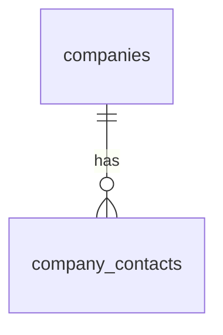

# Phase 1A: Company Management — two-table schema

**Status: schema implemented and applied locally. Updated: 15 October 2026.**

This revision supersedes the earlier eight-table proposal. Company Management has
exactly two business tables: `companies` and `company_contacts`. Alembic also maintains
its standard `alembic_version` bookkeeping table. No address, phone, source-document,
audit-history or contact-phone-link tables are created.

Target verified: local macOS PostgreSQL **18.6**, database **jobmitra_dev**.
Existing pgvector **0.8.7** is unchanged. The reviewed schema migration is applied;
both business tables contain **zero rows**. No spreadsheet data has been imported.

## 1. Source inspection and data quality

Source: [company-dataset.xlsx](../company-dataset.xlsx), `Sheet1!A1:E181`.
There are **180 register entries**, one header row and five columns. Register-entry
grain does not establish that there are 180 distinct real-world companies.
All populated cells in the five columns are strings. No formulas or Excel error
cells were found. No address, email, date or job-description column exists.

| Source column | Nonempty | Missing | Missing rate | Distinct nonempty, raw | Distinct after normalization |
| --- | ---: | ---: | ---: | ---: | ---: |
| A: Register ID | 180 | 0 | 0.00% | 180 | 180 |
| B: Company / client (as read) | 180 | 0 | 0.00% | 167 | 166 |
| C: Contact person(s) (as read) | 163 | 17 | 9.44% | 153 | 153 |
| D: Phone 1 - readable digits | 111 | 69 | 38.33% | 101 | 101 |
| E: Phone 2 - readable digits | 5 | 175 | 97.22% | 5 | 5 |

Missing means `None` or whitespace-only text. No whitespace-only cells, outer
whitespace changes or checked placeholder tokens (`n/a`, `na`, `none`, `null`,
`unknown`, `-`, `nil`, `not available`) were found in populated values.
Normalization for duplicate checks is Unicode NFKC, whitespace collapse and
casefold. It is a comparison operation, not permission to rewrite source values.

### Findings and design implications

| Finding and evidence | Risk / severity | Proposed response |
| --- | --- | --- |
| All 180 Register IDs are unique and match `REG-<digits>`. Numeric suffixes span 1–183, with 103, 104 and 181 absent. | High if IDs are reconstructed from row positions or renumbered. | Preserve exact IDs as text. Gaps are observed, not proof of lost records. Give every company an independent immutable UUID. |
| 13 raw-name duplicate groups contain 26 rows. After normalization, 14 groups contain 28 rows (15.56% of entries); 166 normalized names remain. | High entity-resolution risk; equal names do not prove equal companies. | Use one unique normalized name key for each accepted company. Consolidate exact-key candidates in the review workbook, retaining all source IDs; resolve ambiguous identities before importing. |
| No full five-column row duplicates. Excluding Register ID, two raw-payload pairs match exactly: rows 38/115 and 118/175. A third pair, 120/172, matches after normalization. | High risk of collapsing distinct register entries or overlooking aliases. | Flag all three pairs for review. Retain both original IDs and rows even if a later approved workflow maps them to one company. |
| A name-similarity screen found 11 additional row pairs at a SequenceMatcher ratio of at least 0.82 after removing non-word characters. | Medium; heuristic candidates can be unrelated businesses or branches. | Candidate list only. Similarity is not a probability or an automatic merge rule. |
| 17 entries lack contacts. Ten populated contact cells contain `/`, `&` or `;`. | Medium; forced contact creation invents people, and delimiter splitting can corrupt names/roles. | Permit zero contacts and preserve unsplit original text. Resolve ambiguous contact groups before creating separate people. Exact contact-person count is not established. |
| 111 entries have phones: 106 have only Phone 1 and five have both; 69 (38.33%) have neither. Thirteen entries lack both contact and phone. | Medium; mandatory phone/contact fields would reject valid source entries. | A company can exist with no contacts and no phones. Blank source cells create no placeholder child records. |
| 116 populated phone cells represent 106 distinct digit strings. Ten repeated-phone groups cover 20 cells (17.24%); seven groups span different normalized company names. | High if phone is treated as a company identifier. Shared lines, aliases and transcription issues remain possible. | No global phone uniqueness and no merging by phone. Deduplicate only within a reviewed company scope. |
| 105 phone cells have ten digits; 11 have eleven digits and start with zero. All are digits-only strings. Country and phone type are absent. | High if stored as integers or converted to international numbers by guesswork. | Store text, retain leading zeroes, and keep international normalization optional and explicit. Digit length alone does not prove validity. |
| No address or date columns. | Medium for completeness; freshness cannot be assessed from this file. | Address fields start empty. Do not infer addresses, country, record age or last contact date. |

These counts are direct observations of this workbook. Causes of repeated names or
phone numbers are not verified. Missing optional fields are not necessarily defects.
Historical freshness, trends and schema drift cannot be assessed from one snapshot.

Normalized-name duplicate row groups, using **1-based Excel rows**:

```text
20/34, 23/110, 24/166, 36/116, 38/115, 44/100, 66/147,
109/180, 111/112, 118/175, 120/172, 121/163, 126/164, 129/142
```

For all checked groups and phone-cell references, see the aggregate
[profile JSON](analysis/company-dataset-profile.json). The executed
[companion notebook](analysis/company-dataset-profile.ipynb) contains the exact
read-only calculations and reconciliation assertions. It retains no contact names
or phone digits. Raw row previews are omitted because they contain personal contact
details; headers, aggregates and row references provide the review evidence.

Workbook SHA-256 before and after inspection:
`97936c31d1bc52ccad2f78a347c741118e1557204066ec63b56e0102aee342c0`.

## 2. Implemented schema



### `companies` → `Company`

| Column | Type | Rules |
| --- | --- | --- |
| `id` | UUID | Primary key; Python `uuid4` default on creation only. |
| `company_name` | TEXT | Required, nonblank; editable display name. |
| `company_name_key` | TEXT | Required, nonblank, unique; maintained from company name on ORM insert/update. |
| `general_phone_numbers` | TEXT[] | NOT NULL, default empty array; zero or many unassigned/general phones. |
| `address_line` | TEXT | Nullable and editable; no inferred/default content. |
| `city` | TEXT | Nullable and editable; no inferred/default content. |
| `state` | TEXT | Nullable and editable; no inferred/default content. |
| `postal_code` | TEXT | Nullable and editable; preserve leading zeroes. |
| `source_register_ids` | TEXT[] | NOT NULL, default empty array; retains every accepted original Register ID. |
| `created_at` | TIMESTAMPTZ | NOT NULL, server default `now()`. |
| `updated_at` | TIMESTAMPTZ | NOT NULL, server default `now()`; SQLAlchemy `onupdate=now()`. |

`company_name_key` uses the shared pure normalizer: Unicode NFKC, collapse all
whitespace to single spaces, strip outer whitespace, and casefold. Punctuation,
legal suffixes and word order are retained. Thus ` ACME  Ltd ` and `acme ltd` collide,
while `A.B. Ltd` and `AB Ltd` remain distinct. Do not generate a company ID from its
name. Renaming refreshes the key and preserves the UUID; conflicts fail at the unique
constraint rather than overwriting another company.

### `company_contacts` → `CompanyContact`

| Column | Type | Rules |
| --- | --- | --- |
| `id` | UUID | Primary key; Python `uuid4` default on creation only. |
| `company_id` | UUID | Required FK to `companies.id`, `ON DELETE RESTRICT`; indexed. |
| `contact_name` | TEXT | Nullable and editable. |
| `designation` | TEXT | Nullable and editable. |
| `phone_numbers` | TEXT[] | NOT NULL, default empty array; zero or many phones. |
| `created_at` | TIMESTAMPTZ | NOT NULL, server default `now()`. |
| `updated_at` | TIMESTAMPTZ | NOT NULL, server default `now()`; SQLAlchemy `onupdate=now()`. |

A company can exist with no contact rows and no phones. Contact name and designation
can both be NULL. Multiple contacts are independent child rows; each can have zero
or many phones. The same phone may legitimately occur for different contacts or
companies. A company with contacts cannot be hard-deleted until those references
are explicitly handled; there are no destructive cascades or `delete-orphan` rules.

### Editing and array handling

- Company and contact IDs persist across name, designation, phone and address edits.
- Address fields can be independently edited or cleared to NULL. Missing values
  remain NULL. Updating one address field does not populate other fields.
- Arrays store strings, never integers. Preserve phone leading zeroes. No country
  prefix, extension, person ownership or missing value is guessed.
- Arrays have independent `default=list` values and PostgreSQL empty-array defaults.
  `MutableList` tracks in-place edits. ORM write hooks strip outer whitespace,
  deduplicate exact strings in insertion order and reject blank/nonstring elements.
  Missing phone/ID arrays become empty arrays; no phone/ID values are fabricated.
  Database checks reject NULL elements and required name/key blanks.
- ORM hooks recompute the name key before every insert/update, including an attempted
  stale key override. Core/bulk/raw SQL bypasses ORM normalization and must supply a
  correctly normalized key; it is not the supported editing interface. Database
  uniqueness is authoritative for concurrent normalized-key conflicts.
- `source_register_ids` preserves original text. It is not a replacement UUID.
  Arrays do not enforce global per-element source-ID ownership across companies;
  any future importer must validate each Register ID belongs to one accepted company.
- `updated_at` is maintained for ORM changes to that row. Contact edits update the
  contact timestamp; they do not implicitly change the parent. Direct SQL must set
  timestamps explicitly. No audit/version/archive columns or triggers are included.

Models: `src/jobmitra/modules/companies/models.py`. Shared normalization:
`src/jobmitra/modules/companies/normalization.py`. Both use the existing central
SQLAlchemy 2.x `Base`/engine. PostgreSQL UUID, TEXT[], timezone timestamps and explicit
FK/check/unique constraints map directly to the migration. No UI, CRUD routes,
importer, audit subsystem or AI service is introduced in this phase.

## 3. Separate cleaned workbook

Output: [company-dataset-cleaned.xlsx](../outputs/phase-1a/company-dataset-cleaned.xlsx).
The original workbook remains byte-for-byte unchanged.

| Worksheet | Contents |
| --- | --- |
| Companies | 166 consolidated name-key candidates from 180 source rows, including all source IDs, distinct general phones, name spellings and Excel row references. All four address fields remain blank. |
| Contacts | 159 distinct source contact-text records within company keys. Designations are blank and phone arrays empty because ownership is not established. Delimiter-containing text is preserved unsplit and flagged. |
| Review | 37 review items: 11 differing-payload merge groups, 9 similar-name pairs, 10 ambiguous contact splits and 7 cross-name shared-phone groups. Blank editable Decision/Reviewer note fields; no approvals prefilled. |
| Source Rows | All 180 original data rows and their exact original values, with original Excel row numbers. |

Fourteen exact normalized-name groups are consolidated by stable distinct unions,
never by last-row-wins replacement. Three groups have equivalent normalized payloads;
11 have differing contact/phone information and are provisional merges requiring
identity review. Similar names with different keys stay separate. The earlier profile
counted 11 similar-name *source-row pairs*; the cleaned review queue has 9 distinct
*company-key pairs* after exact-name grouping. These are different grains.

There are 39 company candidates with at least one review issue. The Companies review
flag records the initial findings; entering a decision does not automatically rewrite
candidates, split groups or authorize import. If a reviewer decides same-name entries
are separate businesses, they must supply distinguishing verified company names so
that accepted records have different normalized keys. Never append arbitrary source
IDs to names just to evade uniqueness.

No contact-to-phone association is guessed: every source phone remains at company
level. Contact cells containing multiple people/roles need manual interpretation
before a future import. The Contacts tab is preserved source text, not a claim of
159 verified people. NULL/blank source contacts do not produce placeholder people.

Arrays in the workbook are JSON text for inspectability, not Excel numeric cells.
Source Register IDs, all company-level phone information and every distinct contact
text reconcile to the source. Worksheet-only traceability columns do not become
additional PostgreSQL columns or tables. Source row snapshots stay in the workbook
and source file because the approved database design has no provenance/audit tables.

Cleaning is offline and reproducible via `scripts/clean_company_dataset.py`, using
read-only `openpyxl` and the same normalization helper as the ORM. XLSX authoring,
calculation, rendering and export used the bundled Artifact Tool. Every sheet was
visually inspected; exported cell values, frozen headers, filter tables and review
dropdown were checked independently without rewriting the XLSX. The original source
hash was checked before and after.

## 4. Alembic migration and application

Revision: `0001_company_management`, `down_revision=None`. It creates only the two
business tables, their constraints, and the contact FK index. Alembic creates/updates
its own version ledger. It has no business INSERTs, extension operations or changes
to unrelated tables. [Reviewed upgrade SQL](sql/phase-1a-upgrade.sql) was generated
and inspected **before applying**.

The Alembic environment imports only the approved Companies metadata and filters
reflected tables to these two names, protecting unmanaged objects during future
comparison. Online migrations are currently guarded to local `jobmitra_dev`. Tests
can supply a transaction-bound connection and an isolated version-table schema.

Preflight verified no pre-existing application tables and pgvector 0.8.7. Focused
schema/migration tests ran first in transaction-local disposable schemas. Upgrade,
downgrade and upgrade were tested there; all synthetic rows and test schemas rolled
back. Applying the reviewed migration was a single committed schema-only transaction.
Post-application checks confirmed both business tables empty, the expected revision,
no unrelated table changes and unchanged extension versions. No development database
downgrade was performed. A downgrade would destroy these two business tables and
must not be treated as a safe undo after real data is added.

## 5. Future JD relationships and pgvector isolation

The Jobs module will later reference `companies.id`, preserving company links across
renames and address changes. Optional JD contact references should validate the
contact belongs to that company. This phase creates no JD, candidate, match, audit,
phone, address or extra relation tables.

Future candidate–JD embeddings belong in separate matching-owned tables/migrations.
Company models do not import pgvector, create vector columns/indexes, enable/drop
extensions or depend on AI. Core functionality remains independent of matching.

## 6. Verification and scope boundary

Focused tests only:

```sh
JOBMITRA_RUN_SCHEMA_TESTS=1 .venv/bin/pytest -q \
  tests/test_company_schema.py tests/test_company_migration.py
```

These cover exact table/column scope, nullable addresses, normalization, default
arrays, multiple contacts/phones, tracked array edits, preserved IDs, unique-key
conflicts, FK/deletion rules, migration/model agreement, isolated upgrade/downgrade,
and preservation of unrelated objects and pgvector. The obsolete Phase 0 assertion
that ORM metadata has no business tables was retired; the new exact-two-table test
replaces it. No full-suite run was needed.

Results are recorded in [Phase 1A validation](phase-1a-validation.md). Stop after
Phase 1A schema and cleaned output. No data import or further module implementation
is authorized by completing this phase.
